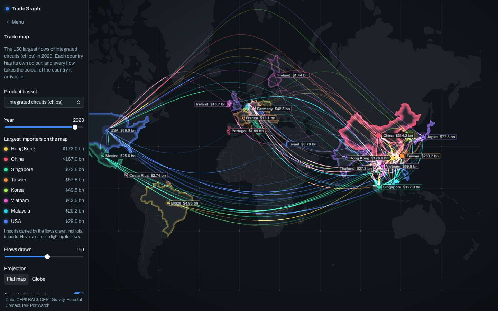
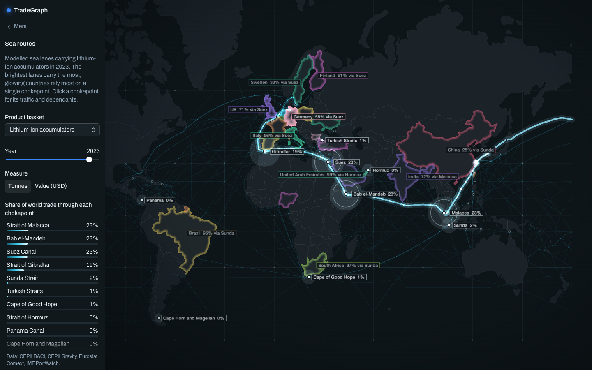
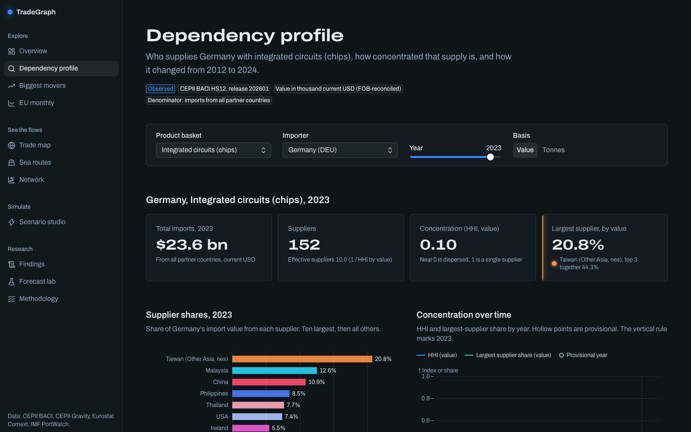
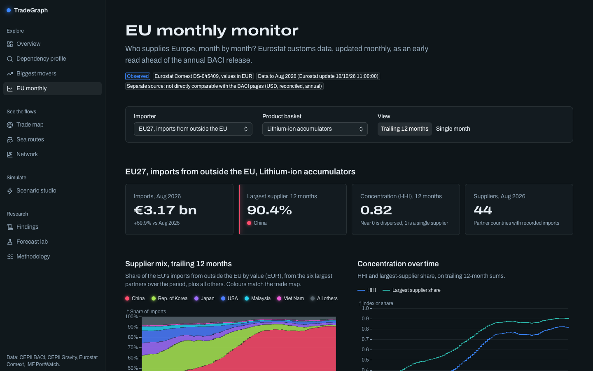
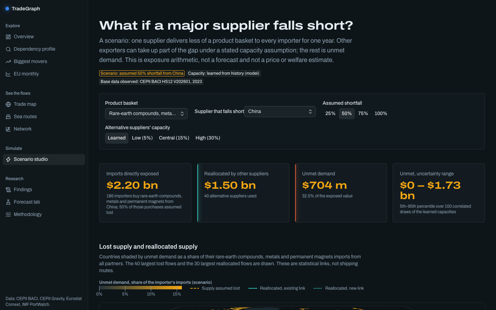

# TradeGraph AI

**How dependent is a country on a few suppliers for a given product, how is that changing, and who could plausibly replace a supplier?**

TradeGraph AI is an open, research-oriented **trade-dependency explorer** built on reconciled bilateral trade data. The Atlas of Economic Complexity, OEC and WITS already map trade flows; TradeGraph focuses on **dependency**. Every number carries its source release, denominator, units and coverage. Everything runs in the browser: the pipeline publishes Parquet files, and the app queries them with DuckDB-WASM, with no backend.



| | |
|---|---|
|  **Sea routes:** modelled lanes and chokepoint reliance |  **Dependency profile:** suppliers and concentration over time |
|  **EU monthly monitor:** Eurostat data, month by month |  **Scenario studio:** who could make up a supplier's shortfall |

More in the [gallery](docs/gallery.md).

## Pages

| Page | What it answers |
|---|---|
| **Overview** | Headline numbers computed live from the data, and entry points to every page. |
| **Dependency profile** | Who supplies country X with product P? How concentrated is that (shares, HHI, effective suppliers), by value and by tonnes, from 2012 to 2024? |
| **Biggest movers** | Where did concentration rise or fall most between 2012–14 and 2021–23? |
| **EU monthly monitor** | Month-by-month supplier shares for the EU and six member states (Eurostat); a nowcast of the years BACI has not reached yet; how imports cross the EU border (sea, air, road, rail). |
| **Trade map** | Where do flows run? Animated flows on a map or globe, coloured by importer. |
| **Sea routes** | Modelled sea lanes and chokepoints (Suez, Hormuz, Malacca, …): which importers rely on which passage, what a closure would reroute, and observed ship traffic. |
| **Network** | Which trade communities exist, who sits at their centre, and who is more central than a gravity model predicts? |
| **Scenario studio** | If a major supplier falls short, how much do others make up, under fixed or learned capacity, how much stays unmet, and how uncertain is that? (Labelled *scenario*.) |
| **Findings**, **Forecast lab**, **Methodology** | Written findings, a forecast benchmark against "same as last year", and how everything is computed. |

**Findings so far:**
- [Rare earths and magnets](reports/m2_rare_earths/finding.md): China's share of German and US imports rose from about 52–58% to 73–77% by value, driven by permanent magnets.
- [Forecast benchmark](reports/m4_forecast/benchmark.md): machine learning beats persistence by about 5% in log error, but last year's value remains very hard to beat for the largest flows.

**Boundary:** aggregate trade data are not firm supply chains, sea routes are modelled rather than tracked, and scenarios are assumptions, not forecasts or causal estimates. See the scientific contract in [`AGENTS.md`](AGENTS.md).

## Data

| Source | Use | Licence |
|---|---|---|
| [CEPII BACI](https://www.cepii.fr/CEPII/en/bdd_modele/bdd_modele_item.asp?id=37) HS12 V202601 | All trade flows (HS6, ~200 countries, 2012–2024; value and tonnes) | Etalab Open Licence 2.0 |
| [CEPII Gravity](https://www.cepii.fr/CEPII/en/bdd_modele/bdd_modele_item.asp?id=8) V202211 | Distance, border, language, colonial ties, trade agreements | Etalab Open Licence 2.0 |
| [Eurostat Comext](https://ec.europa.eu/eurostat/comext/) DS-045409 | Monthly EU imports (HS6), 2017 to the latest month | Eurostat reuse policy (acknowledgement; adapted) |
| Eurostat Comext, trade by mode of transport | How EU imports from outside the EU cross the border, 2012–2026 | Eurostat reuse policy (acknowledgement; adapted) |
| Eurostat `ert_bil_eur_m` | Monthly euro to US dollar rates, based on ECB reference rates | Eurostat reuse policy; ECB data, non-commercial reuse |
| [IMF PortWatch](https://portwatch.imf.org/) | Ports, chokepoints and daily chokepoint transits | IMF terms for statistical data: non-commercial reuse with attribution |
| World Bank WDI | GDP (reserved) | CC BY 4.0 |

Eurostat is not responsible for the adapted figures. Because the exchange rates and PortWatch data are for non-commercial reuse, the published app is non-commercial.

**Product baskets**, editable in [`configs/baskets.yaml`](configs/baskets.yaml): chips, Li-ion batteries, lithium chemicals, rare earths and magnets, bulk antibiotics, and green coffee as a control.

Details are in the [data card](docs/data_card.md), the [model card](docs/model_card.md) and the [source inventory](docs/source_inventory.md).

## Getting started

**Just the app.** The published data the app reads is committed in `app/public/data`, so Node.js 20+ is enough:

```bash
cd app && npm ci && npm run dev    # http://localhost:5173
```

**The full pipeline.** Rebuilding the data from the raw sources needs [uv](https://docs.astral.sh/uv/) (it installs Python 3.12+ itself) and about 7 GB of free disk:

```bash
uv sync                          # Python environment
uv run pytest                    # offline tests on tiny fixtures
uv run tradegraph all            # downloads the sources, validates them and builds every mart (several minutes)
make dev                         # copies the new marts into the app and starts it
```

Individual steps: `uv run tradegraph fetch | curate | marts | wdi | gravity | forecast | scenarios | comext | transport | sea | substitution | nowcast`.

**Different product baskets:** edit `configs/baskets.yaml`, then run `uv run tradegraph marts` (seconds; nothing is re-downloaded), followed by the later steps. Years, releases and benchmark windows are set in `configs/pipeline.yaml`.

## Deploying

The app is a static site. On [Vercel](https://vercel.com), import the repository: [`vercel.json`](vercel.json) builds `app/` and serves `app/dist`, with no further settings. Any static host works the same way: run `cd app && npm ci && npm run build` and serve `app/dist`.

## Architecture

```text
raw snapshots (SHA-256 manifests; git-ignored)
   ─► validated Parquet (DuckDB) ─► marts: dependency · movers · gravity/network · forecast ·
      scenarios · Comext · nowcast · transport mode · sea routes
   ─► app/public/data ─► React + Vite app (deck.gl, Observable Plot, DuckDB-WASM in the browser)
```

## Documents

- [`BLUEPRINT.md`](BLUEPRINT.md): mission, metrics, methods and roadmap
- [`docs/decisions.md`](docs/decisions.md): decision log (ADR-001 onwards)
- [`docs/source_inventory.md`](docs/source_inventory.md): sources, licences and validation evidence
- [`docs/data_card.md`](docs/data_card.md) · [`docs/model_card.md`](docs/model_card.md) · [`docs/gallery.md`](docs/gallery.md)
- [`docs/VISUAL_DESIGN.md`](docs/VISUAL_DESIGN.md): visual language
- [`AGENTS.md`](AGENTS.md) · [`CLAUDE.md`](CLAUDE.md): scientific contract, engineering standards and workflow for contributors and coding agents
- `site/`: the first prototype (Observable Framework), kept for reference; the app in `app/` replaces it
