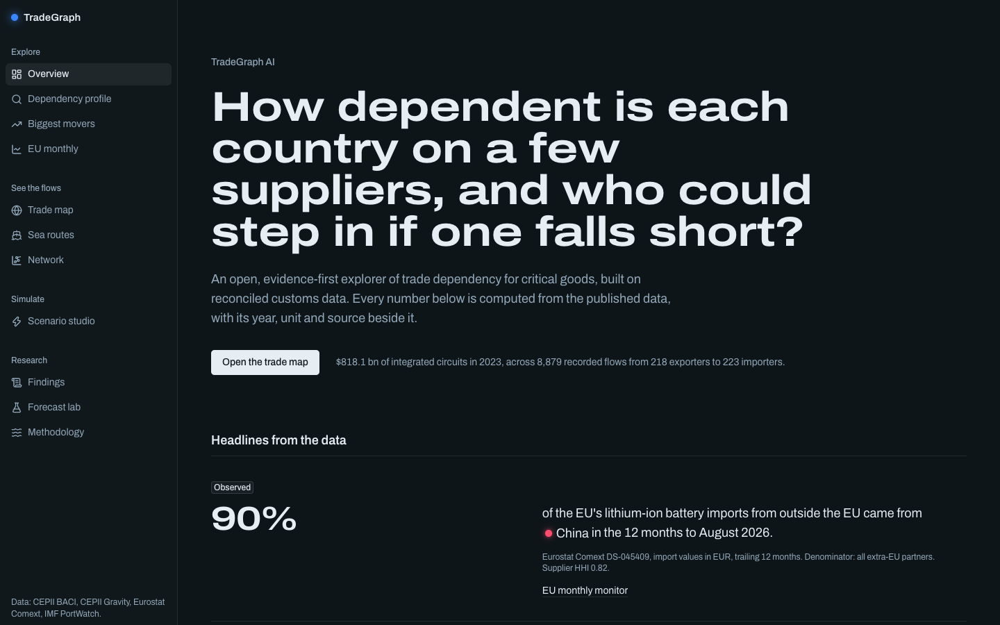
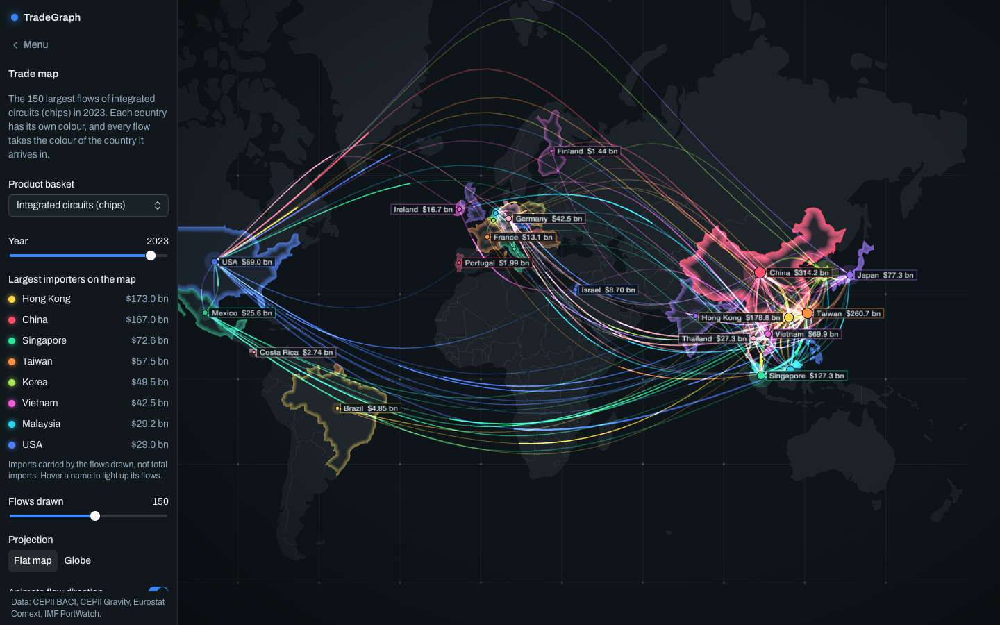
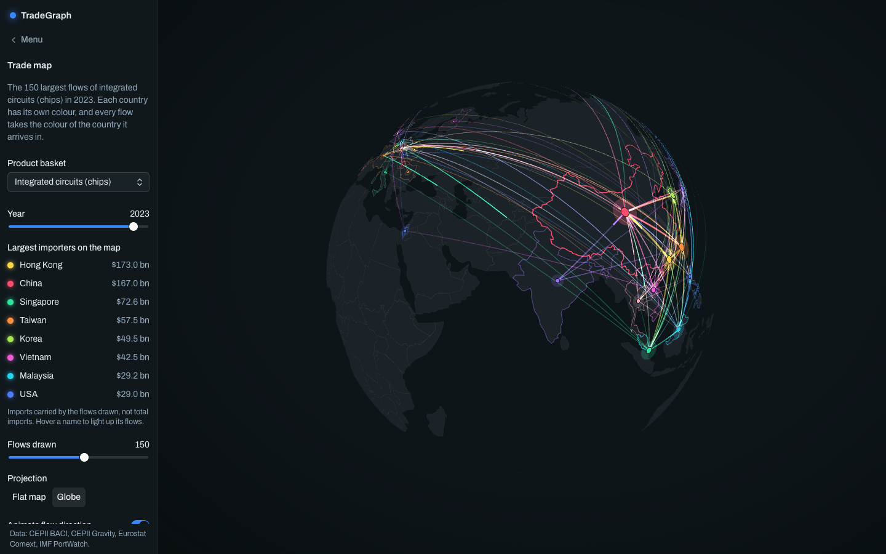
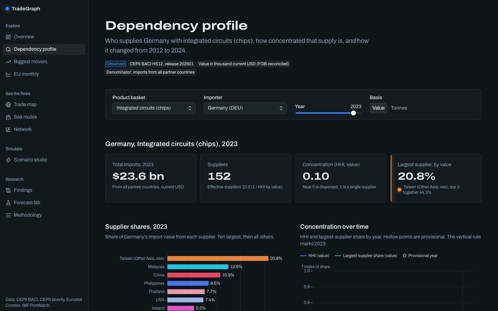
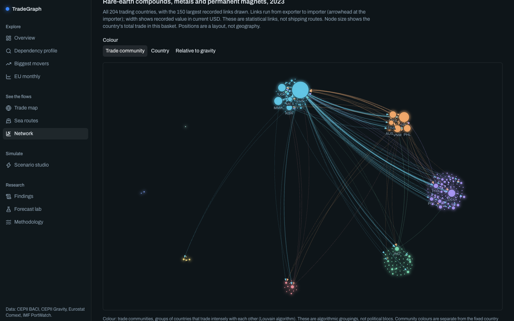
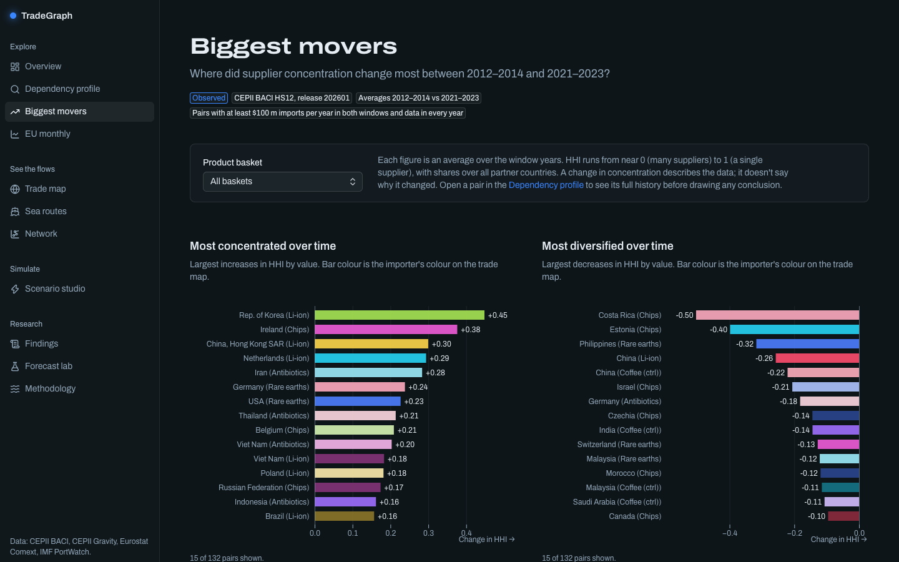
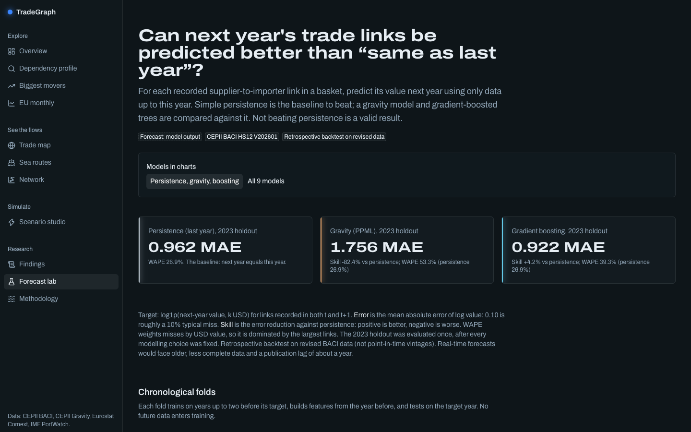
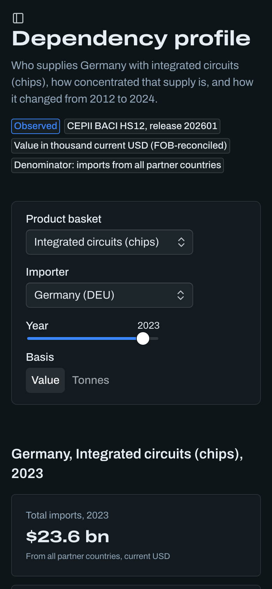

# Gallery

Screenshots of the running app (`make dev`), built from the real pipeline output: CEPII BACI HS12 V202601, Eurostat Comext and IMF PortWatch. They are not mock-ups.

| | |
|---|---|
|  **Overview:** the question the project answers, with headline numbers computed live from the data. |  **Trade map:** the 150 largest chip flows of 2023. Each flow takes the colour of the country it arrives in, and borders glow brighter for bigger traders. The flows are statistical links, not shipping routes. |
|  **Globe view** of the same flows. |  **Sea routes:** modelled lanes carrying lithium-ion batteries in 2023, the share of world trade through each chokepoint, and the countries that rely most on a single passage. |
|  **Dependency profile:** Germany's chip imports in 2023. Supplier shares on an all-partner denominator, and concentration over time. |  **EU monthly monitor:** EU lithium-ion battery imports from outside the EU, month by month, from Eurostat. The supplier mix shows China's rise to about 90%. |
|  **Scenario studio (SCENARIO):** an assumed 50% shortfall in China's rare-earth exports. Capacity learned from past supplier falls gives the reallocated supply, the unmet demand and its uncertainty range. |  **Network:** rare earths in 2023, every trading country grouped into trade communities (Louvain), with the 150 largest links. |
|  **Biggest movers:** the largest changes in supplier concentration between 2012–14 and 2021–23. |  **Forecast lab:** gravity and gradient boosting against "same as last year", on chronological folds and an untouched 2023 holdout. |
|  **Phone layout** (390 px). | |
