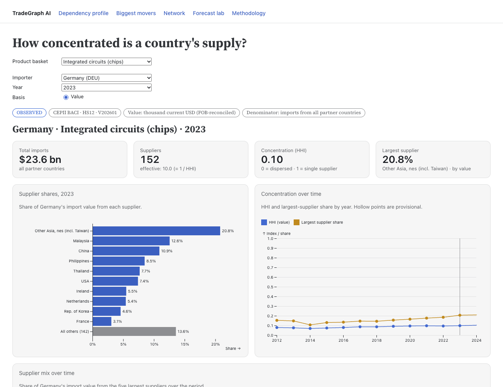
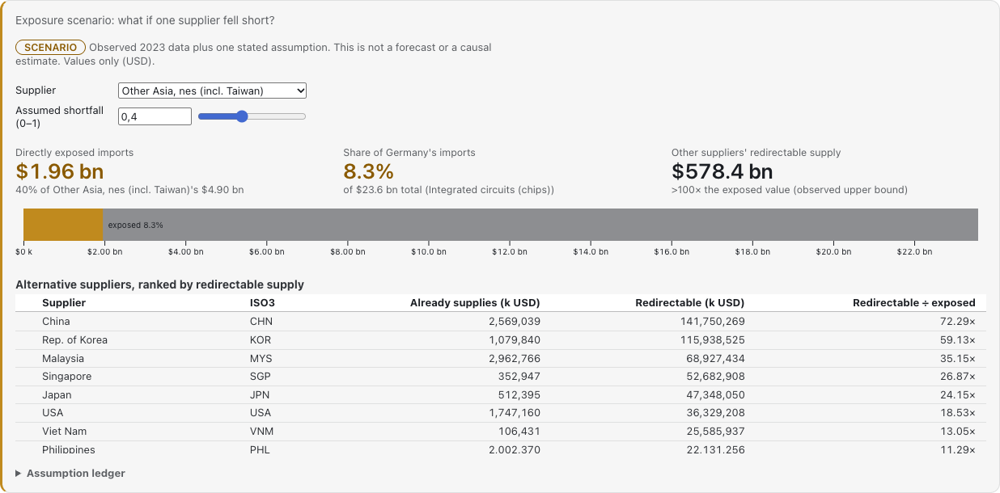
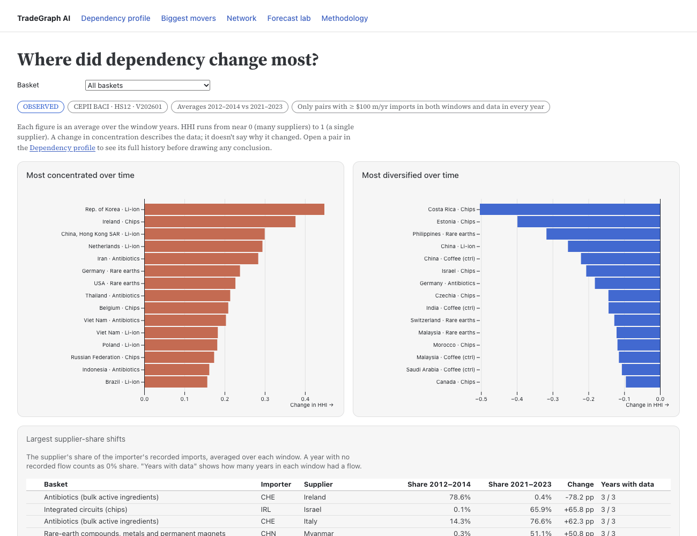
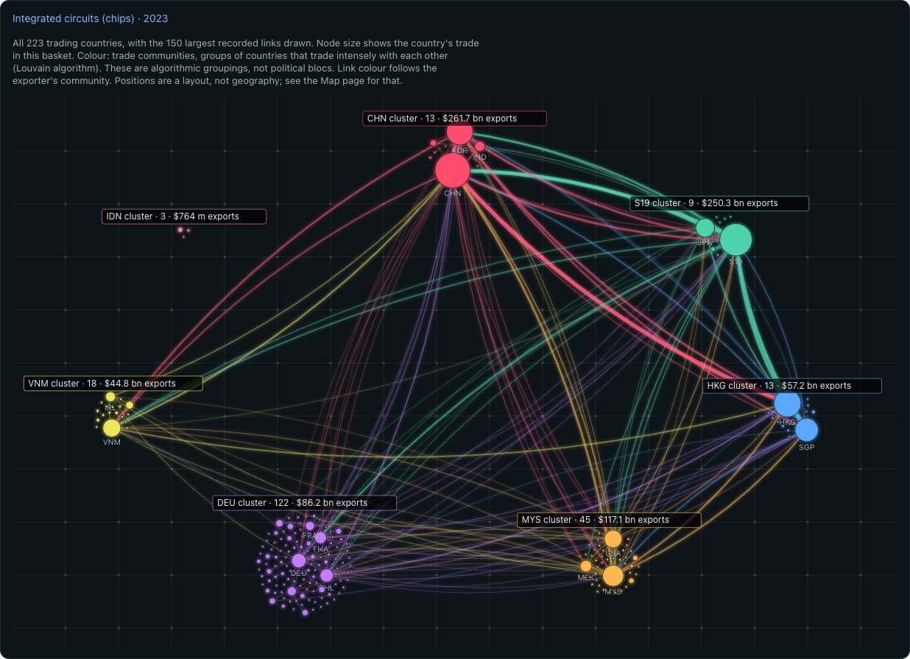
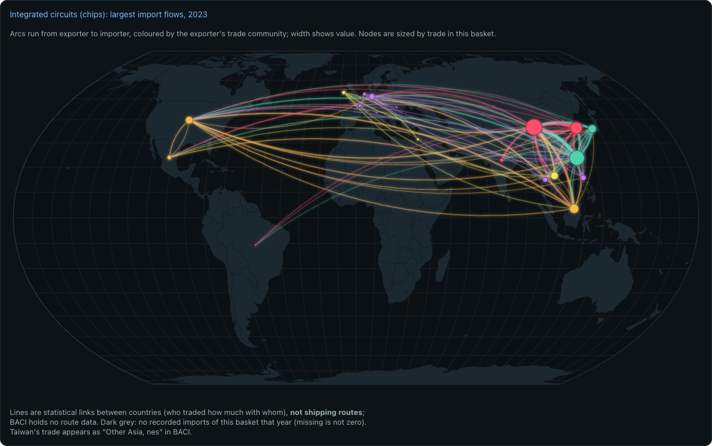
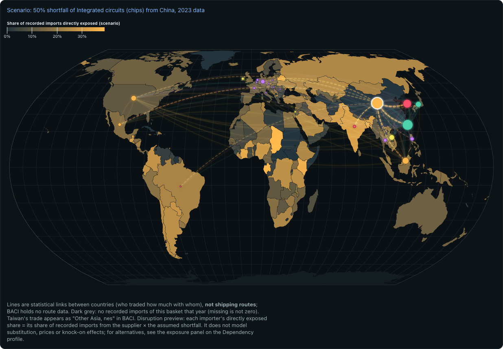
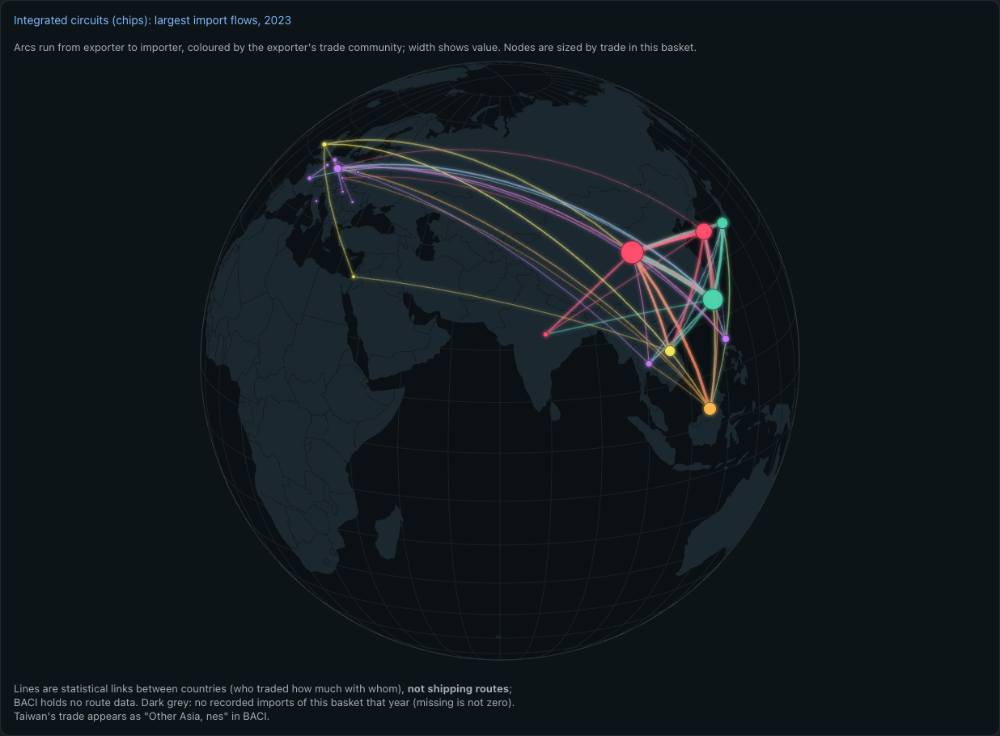
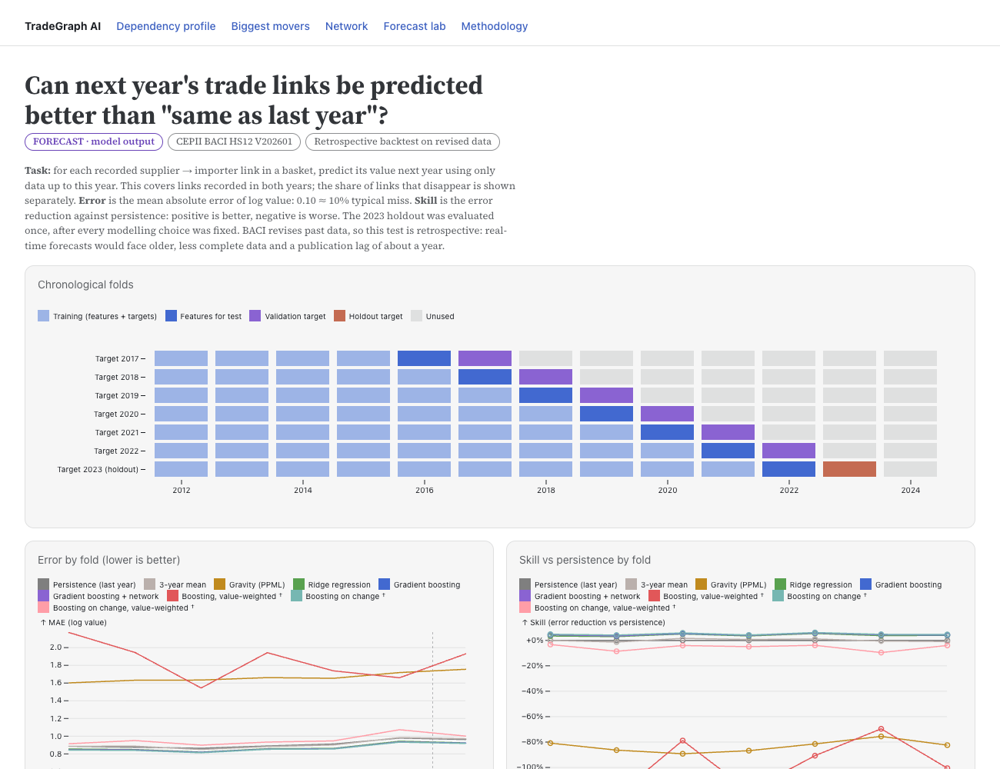
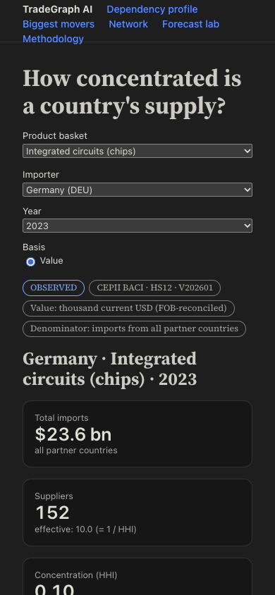

# Gallery

Screenshots of the **running** site (`cd site && npm run dev`), built from the real pipeline output (CEPII BACI HS12 V202601). They are not mock-ups.

| | |
|---|---|
|  **Dependency profile:** Germany's chip imports in 2023. Supplier shares on an all-partner denominator, concentration over time. |  **Exposure scenario:** an assumed 40% shortfall from one supplier, against what alternative suppliers already export elsewhere. Labelled SCENARIO. |
|  **Biggest movers:** largest changes in concentration, 2012–14 vs 2021–23. |  **Network:** chips 2023, every trading country grouped into trade communities (Louvain), with the 150 largest links. |
|  **Trade map:** the largest chip import flows of 2023 as arcs from exporter to importer (statistical links, not shipping routes). |  **Disruption preview (SCENARIO):** an assumed 50% shortfall from China; importers lit by directly exposed share. |
|  **Globe view** of the same flows. | |
|  **Forecast lab:** chronological folds and model errors versus "same as last year". |  **Phone layout** (390 px, dark mode). |

Accessibility: every page passes an automated axe-core WCAG 2 AA audit in light and dark mode (M5).
